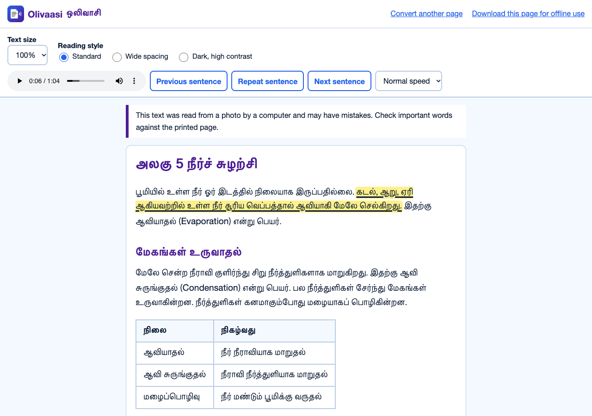

# Olivaasi (ஒலிவாசி)

Olivaasi turns a photo of a printed Tamil or English textbook page into a page a student can read with a screen reader, at a large size, with wide spacing, or by listening while each sentence is highlighted. It runs on a laptop with no internet connection.

It is built for students who are blind, have low vision or find dense print hard to read, in schools where the accessible edition of a page is not on the computer in front of them. See [DESIGN.md](DESIGN.md) for the learner and the problem, and [EVALUATION.md](EVALUATION.md) for measured accuracy, speed and accessibility results and their limits.

**Live demo:** https://olivaasi.140-245-16-129.sslip.io

The demo runs in one small container on an Oracle Cloud Always Free VM; a sample page with audio took about 12 seconds when checked on 11 Nov 2026. Use a sample button or upload your own photo. Each photo is converted in memory (a RAM-backed temporary folder), the page comes back with its audio and photo inside it, and the folder is deleted before the reply is sent: nothing is stored or logged. The demo runs on Linux, so its speech is eSpeak NG, which is robotic; on a Mac Olivaasi uses the much clearer Tamil voice Vani. The optional simplifier is off on the demo.



## What it does

1. Finds the page in the photo, straightens it, evens out the light, and straightens text lines that curve into a book's spine.
2. Reads the text with Tesseract (Tamil and English models), including text that Tesseract's first pass skips.
3. Rebuilds the structure: headings, paragraphs, verse, numbered questions and ruled tables.
4. Writes one self-contained HTML page with real headings, lists and tables, a language tag on every block and every English phrase inside Tamil text, text size and reading style controls, and the original photo one click away.
5. Records the page with the computer's offline voices and highlights each sentence as it is read, with Play, Previous, Repeat, Next and Next heading buttons and three speeds.
6. Optionally adds a simplified version of English paragraphs from a local model, labelled, with the original one tap away. Tamil is not simplified (see [eval/simplification.md](eval/simplification.md)).

The output folder can be copied to a pen drive and opened in any browser.

## Setup (macOS, tested)

You need [Homebrew](https://brew.sh) and [uv](https://docs.astral.sh/uv/). Internet is needed only for these steps.

```sh
brew install tesseract
git clone https://github.com/vignesh2027/olivaasi olivaasi
cd olivaasi
uv sync
sh scripts/get_models.sh
uv run olivaasi doctor
```

`doctor` should report Tesseract, the `tam` and `eng` models, and a Tamil voice. On macOS the Tamil voice is "Vani". If it is missing, add it in System Settings, Accessibility, Spoken Content, System voice, Manage Voices, Tamil.

On Debian or Ubuntu, install `tesseract-ocr`, `espeak-ng` and `ffmpeg` with apt instead of the brew step. The hosted demo runs this path on Debian (see `modal_app.py`); a Linux desktop install has not been tested.

## Use

Start the app and open http://127.0.0.1:8765/ in a browser:

```sh
uv run olivaasi serve
```

Choose a photo, or press one of the sample buttons. Converted pages are kept in `work/` and listed on the home page. Each page can be downloaded as a zip and opened from a pen drive on any computer.

### Optional: simplified English paragraphs

This needs [Ollama](https://ollama.com) and the `gemma3:4b` model (about 3.4 GB, downloaded once):

```sh
brew install ollama
ollama serve &
ollama pull gemma3:4b
```

With Ollama running, the home page offers "Also make a simplified version of English paragraphs". Without it, the option is shown as unavailable and everything else works.

Or convert one photo from the command line:

```sh
uv run olivaasi convert eval/images/ta_water_photo.jpg -o out/ta_water
open out/ta_water/index.html
```

## Tests and evaluation

```sh
uv run pytest
uv run python eval/run_eval.py
```

The evaluation writes `eval/results.md`. The accessibility check, the keyboard walkthrough and the screenshots need the app running in another terminal and Google Chrome installed:

```sh
uv run python scripts/a11y_check.py
uv run python scripts/keyboard_walk.py
uv run python scripts/screenshots.py
```

To regenerate the evaluation images (also needs Chrome): `uv run python scripts/make_pages.py`.

## Hosted demo

`modal_app.py` deploys the demo with `modal deploy modal_app.py`: half a CPU, 1 GB, scale to zero, Tesseract with the same tessdata_best models, eSpeak NG and ffmpeg, and `OLIVAASI_HOSTED=1`. In hosted mode `/convert` and `/sample` return one self-contained page (audio and photo as data URIs), `TMPDIR` is `/dev/shm`, the temporary folder is deleted before the reply, and the stored-page routes return 404.

## Limitations

* Tested on typeset pages and simulated photos and camera captures, not on real textbook pages (see EVALUATION.md for why).
* One text column. Two-column pages are read across both columns.
* Pictures, diagrams and handwriting are not described. Mathematical notation is read as plain text.
* On the harshest photos some coloured headings and question numbers are not recognised as such; the text stays in order.
* Speech quality depends on the voices installed on the computer. The eSpeak NG voice used on Linux, Windows and the hosted demo is robotic. Windows is untested.
* Not yet tested with blind or low-vision students, or by a person using a screen reader.

## Credits

Built during AccessED Hacks (17 October to 20 November 2026); all project code is new work started on 4 November 2026.

* [Tesseract OCR](https://github.com/tesseract-ocr/tesseract) and the [tessdata_best](https://github.com/tesseract-ocr/tessdata_best) Tamil and English models, Apache 2.0.
* [OpenCV](https://opencv.org), Apache 2.0. [NumPy](https://numpy.org), BSD. [FastAPI](https://fastapi.tiangolo.com), [Starlette](https://www.starlette.io) and [Uvicorn](https://www.uvicorn.org), BSD and MIT. [Jinja](https://jinja.palletsprojects.com), BSD.
* Speech: the macOS system voices, or [eSpeak NG](https://github.com/espeak-ng/espeak-ng) (GPL 3.0, run as a separate program).
* Optional simplification: [Gemma 3 4B](https://ai.google.dev/gemma) (Gemma terms of use) through [Ollama](https://ollama.com) (MIT).
* Development only: [axe-core](https://github.com/dequelabs/axe-core) 4.10.2 (MPL 2.0) for accessibility checks, Google Chrome for screenshots, pytest.
* Evaluation text: Thirukkural (public domain) and William Wordsworth, "I Wandered Lonely as a Cloud" (1807, public domain). All other sample text and the logo were made for this project.
